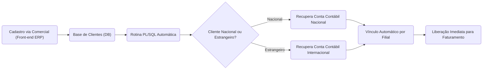

Markdown
# Otimização de Onboarding de Clientes: Automação de Vínculo Contábil (ERP)

## 📌 O Desafio de Negócio
O processo de entrada de novos clientes possuía um gargalo operacional crônico entre departamentos. Sempre que o time Comercial concluía um novo cadastro, o faturamento não podia ser iniciado de imediato. A equipe de vendas precisava enviar um e-mail para o time Fiscal/Contábil, que então acessava o ERP manualmente apenas para vincular a conta contábil correta (Nacional ou Estrangeira) nas respectivas filiais. Esse fluxo manual gerava lentidão no lead time de vendas, acúmulo de e-mails transacionais e risco de atrasos no faturamento devido ao tempo de resposta humano.

## 🎯 O Objetivo
* Eliminar 100% da troca de e-mails entre Comercial e Fiscal para cadastros padronizados.
* Automatizar a vinculação de contas contábeis no ERP baseando-se em regras de negócio (Tipo de Pessoa e Filial).
* Reduzir o tempo de espera (SLA) de liberação do cliente para faturamento imediato.
* Garantir a governança contábil sem intervenção humana, evitando erros de digitação.

## 📐 Arquitetura do Fluxo de Dados

## 🛠️ A Solução Técnica

Desenvolvimento de uma pipeline de automação em PL/SQL injetada no banco de dados do ERP:

Mapeamento Dinâmico (Pivot de Dados): Uso de funções agregadas MAX(CASE WHEN...) para recuperar dinamicamente as contas contábeis atualizadas das filiais parametrizadas, evitando hardcode das contas no script.

Processamento Idempotente: Implementação de validação de existência de registros por cliente e por filial antes das operações de DML (INSERT), garantindo que execuções repetidas da rotina não causem duplicação de dados ou falhas de constraint.

Estrutura de Loops Aninhados Otimizados: O primeiro cursor capta apenas clientes novos e filtrados por carteira. O segundo itera sobre as regras tributárias/empresariais, fazendo a injeção em massa com segurança.

## 🚀 Impacto Esperado (ou Real)

Redução a Zero do Backlog Fiscal: A equipe contábil não precisa mais alocar horas diárias para responder e-mails e parametrizar cadastros sistêmicos.

Aceleração do Faturamento: Clientes novos estão prontos para emissão de nota fiscal instantaneamente após o salvamento do cadastro pelo vendedor.

Confiabilidade de Dados: Prevenção de falhas contábeis onde o preenchimento manual corria o risco de amarrar a conta errada a uma filial específica.
